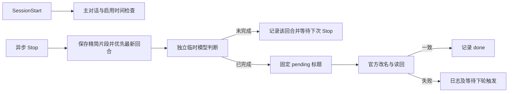

# 运行设计

安装只复制一个独立运行脚本到 `.codex/hooks/first_completion.py`。根目录安装入口和 Skill 都使用 `skills/skr-codex-auto-title/scripts/install.py`；不存在两套运行实现。

每个会话有非阻塞 worker 锁，项目状态事务使用 flock 与原子 replace。API 读回与成功记账阶段持有项目锁，使 disable 与改名串行。安装器另外持有共享 CODEX_HOME 锁，顺序固定为用户配置锁→项目状态锁。所有锁均由 OS 在进程退出后释放。

运行时只通过官方 app-server 协议改名，读取实际 transcript 提取用户请求。独立临时线程指定 ephemeral=true、禁止模型回退，关闭 hooks/shell/apps/multi_agent；如果出现工具或审批事件，客户端终止评估并保留失败。它不需要主对话调用命名工具。CLI 进程短时存在，设置请求和总时限；API 错误不会写成功。

模型请求仅包含首条需求最多 800 字符、最新一条不同补充最多 400 字符、答复首尾最多 1600 字符、最多三段各 100 字符的未完成/待确认提醒、模块参考最多 400 字符。选中正文合计最多 3500 字符，另有 JSON 字段和简短规则。短文本保留原文，长文本标记省略；请求只保留首条及最新一条，不重复发送首条。材料按不可信数据处理，提醒片段不是直接结论。片段可能遗漏事实，无法保证判断完全正确。

本地 settings、状态、队列、证据、日志与安装备份都在被忽略的 runtime 子目录，文件按私有权限写入。模型判定及标题会使用账号额度。证据可含代码、用户输入和最终答复，不应公开提交；本仓库不携带真实会话、账户配置、凭据或个人路径。

恢复策略是保留 pending 后读回：若改名已生效但响应丢失，下一轮先读回原标题，不重复写名。已有 pending 时跳过新的对话取材，缺请求或长回复都不阻断改名重试。每次失败直接停止，保留任务，下一轮 Stop 再处理；没有定时后台服务。无 pending 时新回复替代未成功评估的旧回复。RPC 整体时限 60 秒，单个请求 10 秒，模型结果等待 25 秒，异步 Stop 外层时限 75 秒。恢复/压缩不重置成功状态。

## 安装范围与跨范围协调

项目安装注册在项目 .codex/hooks.json；全局安装注册在 CODEX_HOME/hooks.json。全局独立存储根为 CODEX_HOME/skr-codex-auto-title，运行脚本及 runtime 布局沿用同一实现。全局读取真实会话项目位置并应用项目开关；独立项目安装负责自己的目录树，全局遇到未卸载的项目安装时跳过。

所有安装共用所选 CODEX_HOME/skr-codex-auto-title/coordination：每会话 worker 锁避免跨范围并发；成功凭据避免切换范围后重复命名；pending 固定待重试标题。项目策略锁与最终改名读回串行，关闭项目的命令返回后不会再由已评估的旧任务改名。锁顺序为策略锁→当前安装状态锁；项目开关持有用户配置锁→策略锁；普通启停持有用户配置锁→当前状态锁。

项目开关以规范化绝对路径保存，子目录取最长路径规则。全局的项目关闭约束两种安装范围。全局和项目总开关各自独立。全局安装不向业务项目写文件；私有共享凭据、项目路径与状态留在个人目录，公开分发不携带。

跨安装范围保留处理资格：coordination/accepted 记录本工具曾接手的稳定会话 ID。新安装的启用时间只排除从未接手的旧会话；已有记录仍必须通过主会话、范围、项目开关和排除 ID 检查。登记前验证会话 ID 格式。

失败交接在会话状态锁保护下检查新的排队任务，不立即重试同一失败任务；后台整体预算仍为60秒，预算耗尽的任务保留到后续触发。空闲退出在同一锁下释放worker锁，避免关闭连接期间丢失新触发。安装器长期命令使用基础Python而非下载目录的虚拟环境，更新时一并修正命令和信任记录。
